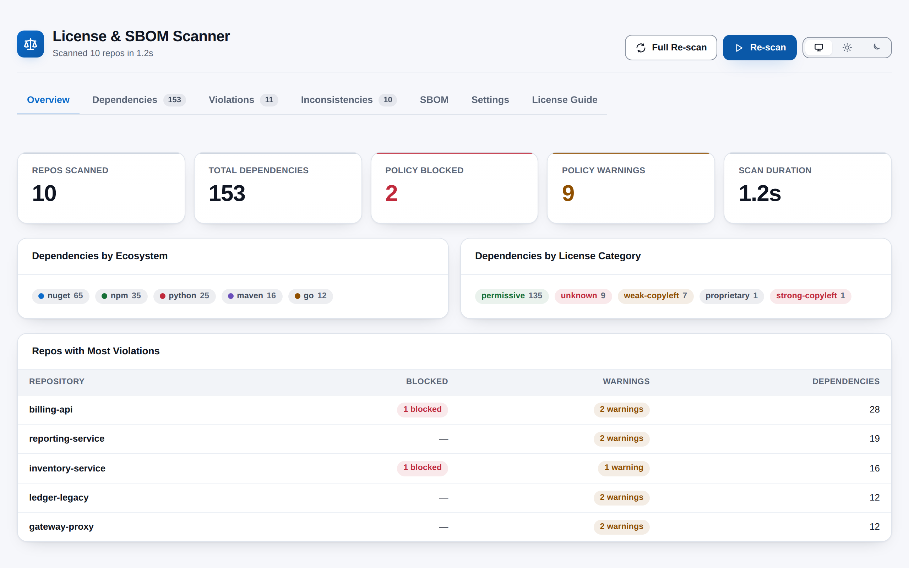
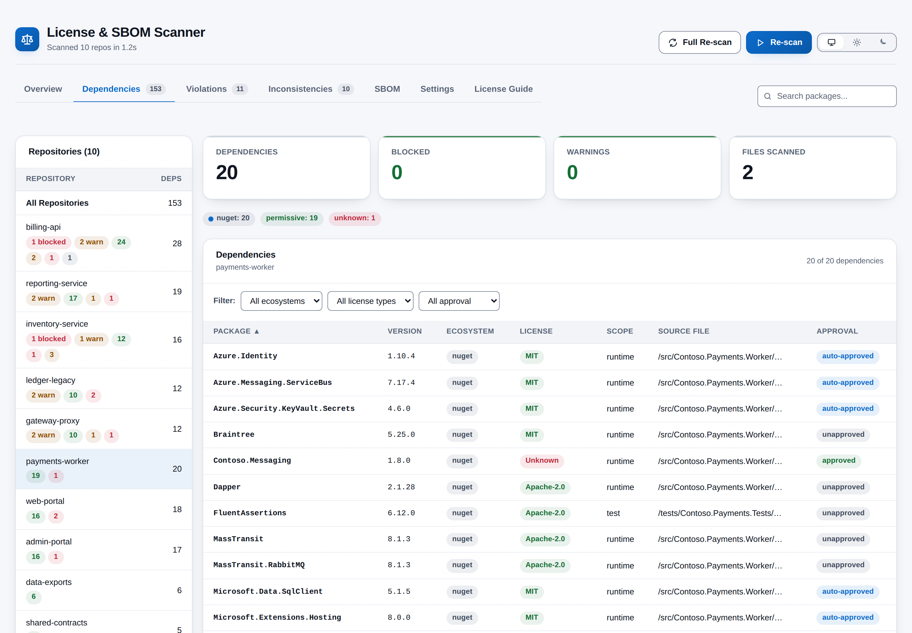
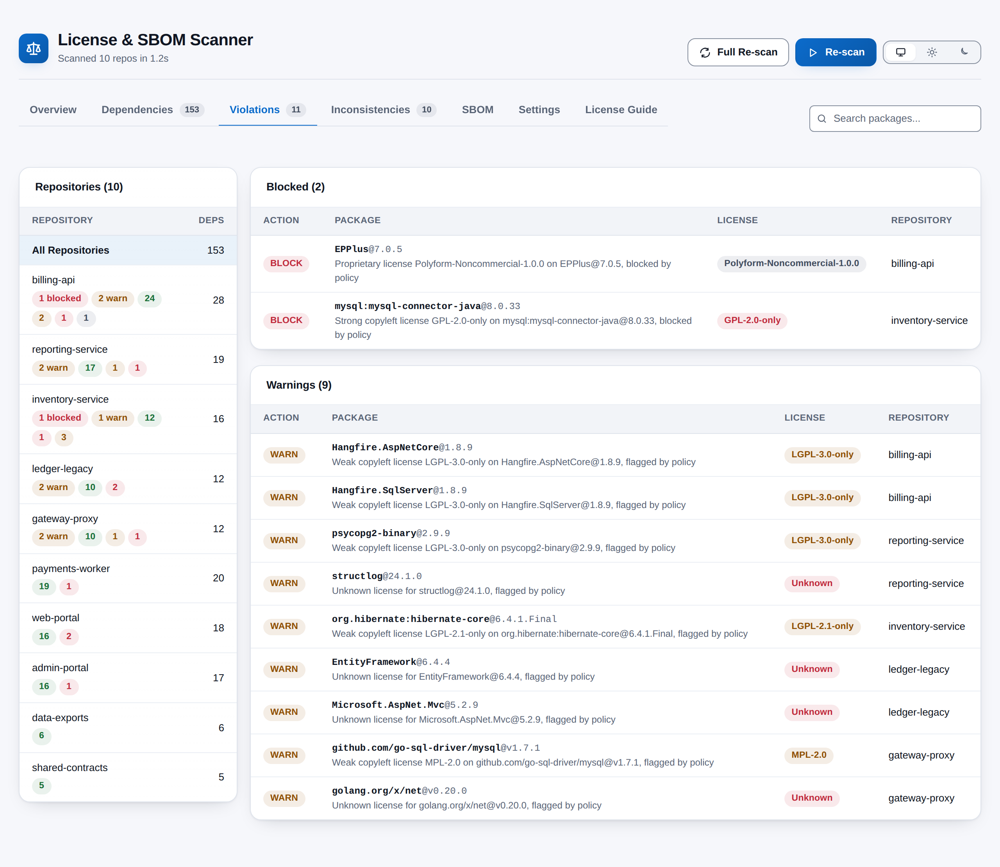
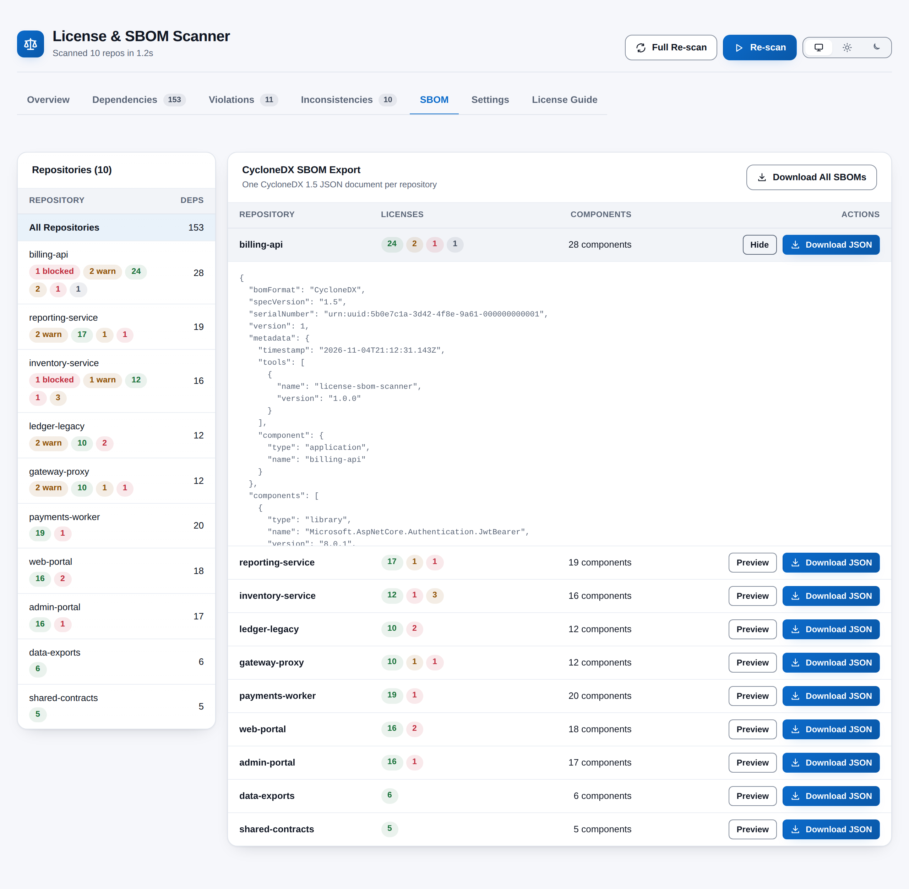
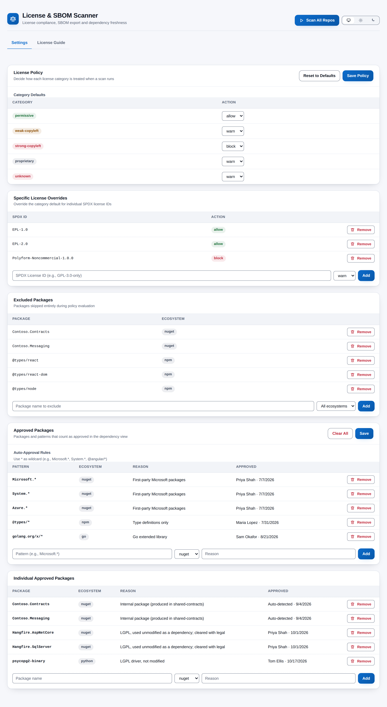

# License & SBOM Scanner

[](https://github.com/adam-wheater/azure-devops-license-sbom-scanner/actions/workflows/ci.yml)

An Azure DevOps extension that scans every Git repository in a project and answers one question: **which third-party packages are we shipping, under what licenses, and does that comply with our policy?** It reads the dependency files of NuGet, npm, Go, Python and Maven projects, resolves each package to an SPDX license, grades it against an Allow / Warn / Block policy you set, flags packages pinned at different versions in different repositories, and exports a CycloneDX 1.5 SBOM for each repository. It is built for engineering leads, platform teams and anyone who has to sign off a compliance review without a backend to run. Everything runs in the browser from a hub under **Repos > Compliance**, reading your code through the Git REST API, and nothing leaves your organisation.



## Table of contents

- [Getting started](#getting-started)
- [Features](#features)
- [Screens](#screens)
  - [Header, progress and messages](#header-progress-and-messages)
  - [Overview tab](#overview-tab)
  - [Dependencies tab](#dependencies-tab)
  - [Violations tab](#violations-tab)
  - [Inconsistencies tab](#inconsistencies-tab)
  - [SBOM tab](#sbom-tab)
  - [Settings tab](#settings-tab)
  - [License guide tab](#license-guide-tab)
- [How it works](#how-it-works)
- [Settings reference](#settings-reference)
- [Rules and detection logic](#rules-and-detection-logic)
  - [Dependency file discovery](#dependency-file-discovery)
  - [Ecosystem parsers](#ecosystem-parsers)
  - [License resolution](#license-resolution)
  - [License categories](#license-categories)
  - [Policy evaluation](#policy-evaluation)
  - [Approval status](#approval-status)
  - [Version freshness and inconsistencies](#version-freshness-and-inconsistencies)
  - [SBOM document](#sbom-document)
  - [Scan cache](#scan-cache)
- [Scopes & permissions](#scopes--permissions)
- [Privacy](#privacy)
- [Troubleshooting and known limitations](#troubleshooting-and-known-limitations)
- [Development](#development)
- [Project structure](#project-structure)
- [Tech stack](#tech-stack)
- [Contributing](#contributing)
- [License](#license)

## Getting started

1. Install **License & SBOM Scanner** by publisher `adam-wheater` from the Visual Studio Marketplace (the listing carries the **Preview** flag).
2. Open a project. The hub is contributed to the **Repos** hub group (`ms.vss-code-web.code-hub-group`, order 99) and appears last in the Repos menu as **Compliance**.
3. On first open the hub shows an empty-state card and only the **Settings** and **License Guide** tabs. Opening it seeds the two settings documents with the default policy (Permissive allow, Weak Copyleft warn, Strong Copyleft block, Proprietary warn, Unknown warn) and an empty approved-packages registry. Nothing is scanned until you press **Scan All Repos**.
4. Optionally adjust the policy and approved packages under **Settings**, then press **Scan All Repos**. The first scan reads every repository; later scans within 30 minutes reuse cached repositories, and **Full Re-scan** forces a fresh read. Saved settings apply to everyone in the organisation.

## Features

- **Five ecosystems, one scan** -- NuGet (`.csproj`, `packages.config`, `Directory.Packages.props`, `.nuspec`), npm (`package.json`, `package-lock.json` v1/v2/v3), Go (`go.mod`), Python (`requirements*.txt`, `pyproject.toml`, `setup.py`, `setup.cfg`, `Pipfile`) and Maven (`pom.xml`), from every repository in the project in a single pass.
- **Three-tier license resolution** -- A license declared in the manifest first, then a built-in registry of 352 widely used packages, otherwise `Unknown`. Common license names are normalised to SPDX identifiers.
- **Five license categories** -- Every SPDX identifier the scanner knows is Permissive, Weak Copyleft, Strong Copyleft or Proprietary / Restrictive; everything else is Unknown.
- **Configurable policy engine** -- Each category maps to Allow, Warn or Block, with per-SPDX-ID overrides and package exclusions. The policy is re-applied to cached results, so a settings change shows up on the very next scan.
- **Approved packages** -- Approve packages individually or by wildcard pattern such as `Microsoft.*`, per ecosystem, and let the scanner auto-approve the NuGet packages your own repositories produce.
- **Cross-repository version inconsistencies** -- Every package pinned at more than one version across repositories, with major-version differences marked.
- **CycloneDX 1.5 SBOM export** -- One JSON document per repository with a Package URL for every component, previewable in place and downloadable one at a time or all together.
- **Built-in license guide** -- A searchable reference of the 40 recognised licenses with their key obligations and the default policy action for each category.
- **30-minute scan cache** -- Repository results are reused for half an hour within the page, so a re-scan after a settings change is near-instant. **Full Re-scan** bypasses the cache.
- **Cancellable, concurrent scans** -- **Cancel** aborts between phases and nothing from the cancelled run is shown. Up to 15 repositories are scanned in parallel and up to 20 files per repository are fetched in parallel.
- **Shared settings** -- The license policy and the approved packages are stored in the Azure DevOps Extension Data Service at organisation scope, so one policy applies to every project and every user.
- **Theme follows Azure DevOps** -- Light, dark and high-contrast host themes are detected from the SDK's `themeApplied` event, with a header toggle to pin light or dark that is remembered per browser. The toggle is hidden under high contrast.
- **WCAG AA contrast** -- Both palettes clear 4.5:1 for text and 3:1 for UI boundaries, and every colour-coded badge also carries its category as text.
- **Error boundary** -- A top-level React error boundary catches rendering failures and offers a **Try again** button that reloads the hub.

## Screens

### Header, progress and messages

The header is the shared `AppShell`: the brand mark and product name on the left with a subtitle that reads the tagline ("License compliance, SBOM export and dependency freshness") before a scan and `Scanned N repos in X.Xs` after one, and the actions on the right.

| Control | When shown | Behaviour |
|---------|------------|-----------|
| **Scan All Repos** (primary) | No results yet | Starts a scan; the label becomes **Scanning...** with a spinner and the button is disabled while a scan runs. It is also disabled until the saved policy and approved packages have loaded |
| **Re-scan** (primary) | Results present, not scanning | Starts another scan, reusing cached repositories under 30 minutes old |
| **Full Re-scan** | Results present, not scanning | Clears the cache and starts a scan; tooltip "Ignore cached results" |
| **Cancel** (danger) | While scanning | Aborts the scan; a warning banner reads "Scan cancelled." |
| **Theme toggle** | Always, except under high contrast | Three-way segmented control: follow Azure DevOps, always light, always dark |

Below the header a toolbar carries the tab strip and, on the Dependencies, Violations and Inconsistencies tabs, a **Search packages...** box. Before the first scan only **Settings** and **License Guide** are available, and Overview shows an empty-state card titled "License & SBOM Compliance Scanner" with a short explanation and a **Scan All Repos** button. After a scan **Overview**, **Dependencies**, **Violations**, **Inconsistencies** and **SBOM** appear in front of them, with live counts on Dependencies (total dependencies), Violations (total violations) and Inconsistencies (packages with inconsistent versions). Starting a scan returns the view to Overview and clears the previous result.

While a scan runs a progress section appears under the toolbar:

- A progress bar labelled with the orchestrator's message: "Fetching repositories..." (indeterminate, because the total is not yet known), "Scanning repositories...", `Scanning <repo>...` and `Scanned N of M repositories...`, with a `N / M` counter once the total is known.
- Fine print beneath it: `N from cache` when cached repositories were reused and `N failed` (with `role="status"`) when a repository threw during discovery, fetch or parsing. Failed repositories are left out of the result; the scan itself still completes.

Banners stack above the content and each is dismissible unless noted:

| Banner | Tone | Text |
|--------|------|------|
| Cancelled | Warning | "Scan cancelled." |
| Scan failed | Error | Title "Scan failed" followed by the error message (for example "Could not determine the current project.") |
| Policy unavailable | Error, not dismissible | Title "License policy could not be loaded or saved", the error, and "Scans use the default policy until this is resolved." |
| Approved packages unavailable | Error, not dismissible | Title "Approved packages could not be loaded or saved" followed by the error |
| Auto-approval | Success | "N new internal package(s) were auto-approved." after a scan found NuGet package IDs not yet in the registry |

Error banners use `role="alert"`; the others use `role="status"`.

### Overview tab

Five metric tiles, two breakdown cards and, when there is at least one violation, a league table.

| Metric | Definition | Tone |
|--------|------------|------|
| **Repos Scanned** | Number of repositories that returned a result (repositories with no dependency files, and failed ones, are not counted) | Neutral |
| **Total Dependencies** | Sum of de-duplicated dependencies across all scanned repositories | Neutral |
| **Policy Blocked** | Count of violations whose action is `block` | Red (danger) when > 0, green (success) when 0 |
| **Policy Warnings** | Count of violations whose action is `warn` | Amber (warn) when > 0, green when 0 |
| **Scan Duration** | Wall-clock time from clicking scan to the aggregated result, in seconds to one decimal | Neutral |

**Dependencies by Ecosystem** shows one neutral pill per ecosystem (`nuget`, `npm`, `go`, `python`, `maven`), each with a coloured dot taken from the chart palette and the dependency count, sorted by count descending. **Dependencies by License Category** shows one pill per category toned by category (see [License categories](#license-categories)) with its count, also sorted descending. Both cards read "No dependencies found." when empty.

**Repos with Most Violations** lists up to ten repositories that have at least one violation, in the result order (violations descending, then dependencies descending), with columns Repository, Blocked (red pill `N blocked`, or a dash), Warnings (amber pill `N warnings`, or a dash) and Dependencies.

### Dependencies tab



The Dependencies, Violations and SBOM tabs share a two-column layout: a repository list on the left (220-280 px) and the detail for the current selection on the right.

#### Repository list

A card titled `Repositories (N)` with a table of clickable rows (also operable with Enter or Space; the selected row is highlighted and exposes `aria-pressed`):

- The first row, **All Repositories**, is selected by default and shows the total dependency count. With it selected, the right-hand column aggregates every repository.
- One row per scanned repository showing its name (truncated with a tooltip), a red `N blocked` pill and an amber `N warn` pill when applicable, one small pill per license category present (count only, with the category name available to screen readers and in the tooltip), and the dependency count in the right-hand column.

#### Repository detail header

When a single repository is selected, four metric tiles and a row of pills precede the table:

| Metric | Definition | Tone |
|--------|------------|------|
| **Dependencies** | De-duplicated dependency count for the repository | Neutral |
| **Blocked** | Violations with action `block` | Red when > 0, green when 0 |
| **Warnings** | Violations with action `warn` | Amber when > 0, green when 0 |
| **Files Scanned** | Number of dependency files whose content was fetched and parsed | Neutral |

The pill row shows `ecosystem: count` for each ecosystem (neutral, with a chart-colour dot) and `category: count` for each license category (toned by category).

#### Dependency table

A card titled **Dependencies** with the repository name (or "All Repositories") as its hint and a `N of M dependencies` counter reflecting the active filters.

| Column | Content | Sortable |
|--------|---------|----------|
| **Package** | Package name in monospace. For Maven this is `groupId:artifactId`; for Python it is the PEP 503-style normalised name | Yes |
| **Version** | The version string exactly as written in the manifest (`^4.17.21`, `[6.0.0,)`, `${spring.version}` and `*` are all possible) | Yes, using a numeric collator so `10.0.0` sorts after `2.0.0` |
| **Ecosystem** | Neutral pill: `nuget`, `npm`, `go`, `python` or `maven` | Yes |
| **License** | `LicenseBadge`: the SPDX ID (or raw declared string, or `Unknown`) in a pill toned by category, with the category appended as screen-reader text and in the tooltip | Yes |
| **Scope** | `runtime`, `dev`, `peer`, `optional` or `test` as determined by the parser | Yes |
| **Source File** | Repository path of the manifest the dependency came from, truncated to 200 px with a tooltip | No |
| **Approval** | Pill: `approved` (green), `auto-approved` (blue, info) or `unapproved` (grey). Always shown; every row reads `unapproved` until an approval or rule matches it | No |

Filters above the table: **ecosystem** (All ecosystems or one of the five), **license type** (All license types or one of the five categories) and **approval** (All approval, Approved, Auto-approved, Unapproved). The toolbar search matches case-insensitively against package name, license and version. Default sort is Package ascending; clicking the active header flips the direction and the header carries `aria-sort`.

Results are paginated at 100 rows with **Prev** / **Next** buttons and a `Page X of Y` label; changing any filter or sort returns to the first page. When nothing matches, a single row reads "No dependencies found matching the current filters."

### Violations tab



Violations are grouped into two cards, **Blocked (N)** and **Warnings (N)**, each rendered only when it has rows. The toolbar search matches package name, license and repository name.

| Column | Content |
|--------|---------|
| **Action** | Pill reading `BLOCK` (red) or `WARN` (amber) |
| **Package** | `name` in bold monospace followed by `@version` in muted text, then the engine's reason on a second line (see [Policy evaluation](#policy-evaluation) for the wording) |
| **License** | `LicenseBadge` toned by category |
| **Repository** | Repository the violation belongs to |

Empty states: "No policy violations" / "No policy violations found. All dependencies comply with your license policy." when the selection has none, and "No matches" / "No violations match the current search." when the search filters everything out. Approval status has no effect here; see [Approval status](#approval-status).

### Inconsistencies tab

Shows every package that appears at more than one distinct version string across the scanned repositories. If there are none, a card reads "Versions are consistent" / "No version inconsistencies detected across repositories."

Otherwise a toolbar shows the heading **Version Inconsistencies**, a `N of M packages` counter and the view's own filter box ("Filter by package, ecosystem, or repo...", matching package name, ecosystem, repository name or version). Each package is a card:

- Title: the package name in monospace; hint: `V versions across E repos` where E counts repository/version pairs.
- Actions: a neutral ecosystem pill and a severity pill: red **Major diff** when the leading integer of the versions differs, otherwise amber **Minor diff**.
- A table with a **Version** column and a **Repositories** column listing a neutral pill per repository on that version. Versions are sorted by semantic version (major, minor, patch); strings that are not `major.minor.patch` sort after those that are.

"No matches" / "No inconsistencies match the current filter." appears when the filter removes every card.

### SBOM tab



A card titled **CycloneDX SBOM Export** with the hint "One CycloneDX 1.5 JSON document per repository". With **All Repositories** selected every repository is listed and a **Download All SBOMs** button appears in the card header when there is more than one; with a single repository selected only that row is shown and the bulk button is hidden.

| Column | Content |
|--------|---------|
| **Repository** | Repository name |
| **Licenses** | One small pill per license category present, toned by category, showing the count with the category available to screen readers |
| **Components** | `N components` from the generated document |
| **Actions** | **Preview** / **Hide** toggles an inline, scrollable (400 px) pretty-printed JSON view with `aria-expanded`; **Download JSON** saves `<repo>-sbom-cyclonedx.json` and is disabled when the document has no components |

**Download All SBOMs** triggers the per-repository downloads sequentially with a 300 ms pause between them, skipping repositories with zero components, and reads **Downloading...** while it runs. The empty state reads "Nothing to export" / "No repositories with dependencies found."

### Settings tab



Settings are available before any scan. The tab renders two editors one above the other, each with its own local draft, an **Unsaved changes** pill when the draft differs from what is stored, and its own save button. Changes take effect on the next scan; the policy is also re-applied to cached repositories.

#### License policy

A card titled **License Policy** ("Decide how each license category is treated when a scan runs") with **Reset to Defaults** and **Save Policy** in its header. Both are disabled while the settings are loading or a save is in progress; Reset writes the defaults immediately without a confirmation dialog.

- **Category Defaults** -- one row per category (`permissive`, `weak-copyleft`, `strong-copyleft`, `proprietary`, `unknown`) with a select offering `allow`, `warn` or `block`.
- **Specific License Overrides** -- a table of SPDX ID and action (toned pill) with a **Remove** button per row, and a form with an SPDX ID text box (placeholder "SPDX License ID (e.g., GPL-3.0-only)"), an action select and **Add**. Adding an ID that already exists (case-insensitively) updates that row rather than adding a duplicate, because the engine only honours the first match. Empty state: "No overrides configured."
- **Excluded Packages** -- a table of package name and ecosystem (a neutral pill, or "all ecosystems") with **Remove**, and a form with a package-name box, an ecosystem select defaulting to All ecosystems, and **Add**. Exact duplicates (same name and ecosystem) are ignored. Empty state: "No packages excluded."

#### Approved packages

A card titled **Approved Packages** ("Packages and patterns that count as approved in the dependency view") with **Clear All** (danger) and **Save** in its header. Clear All writes an empty registry immediately without a confirmation dialog.

- **Auto-Approval Rules** -- help text "Use * as wildcard (e.g., Microsoft.*, System.*, @angular/*)"; a table of Pattern, Ecosystem, Reason and Approved (`who · date`) with **Remove**; and a form with a pattern box, an ecosystem select (default `nuget`), a reason box and **Add**. The approver is the signed-in user's display name from `SDK.getUser()` (or "Unknown"); the reason defaults to "Auto-approval rule". A pattern already present for the same ecosystem (case-insensitive) is ignored. Empty state: "No auto-approval rules configured."
- **Individual Approved Packages** -- the same layout keyed on package name, with the reason defaulting to "Approved". Entries the scanner added itself show **Auto-detected** as the approver and `Internal package (produced in <repo>)` as the reason. Empty state: "No individually approved packages."

### License guide tab

A reference that needs no scan. The top card, **License Guide**, shows the five categories side by side: a toned category pill, a plain-language description and the **Default policy** action as a toned pill (Allow green, Warn amber, Block red).

Below it a toolbar offers a **Search licenses...** box (matching SPDX ID, full name and summary) and a segmented filter -- All, Permissive, Weak Copyleft, Strong Copyleft, Proprietary -- with a `N licenses` counter. The 40 recognised licenses are then listed in one card per category, in the order Permissive, Weak Copyleft, Strong Copyleft, Proprietary, with columns **SPDX ID** (toned pill), **Full Name** and **Key Obligations**. When nothing matches, a card reads "No licenses match your search."

## How it works

```
+--------------------+      +------------------------+      +---------------------------+
| User clicks        |      | ScanOrchestrator       |      | Azure DevOps REST API     |
| "Scan All Repos"   | ---> | resolves project via   | ---> | GitRestClient             |
|                    |      | IProjectPageService    |      |  .getRepositories(project)|
+--------------------+      +------------------------+      +---------------------------+
                                        |                               |
                                        v                               |
                            +------------------------+                  |
                            | per repository (max 15 |                  |
                            | in parallel):          |                  |
                            |  cache hit? -> reuse   |                  |
                            |  else                  |                  |
                            |   1 discoverFiles  ----+---> getItems(repo, "/", Full)
                            |   2 fetchFileContents -+---> getItemText(repo, path)
                            |     (max 20 parallel)  |      (skip > 1 MB)
                            |   3 parse (5 parsers)  |
                            |   4 LicenseResolver    |
                            |   5 PolicyEngine       |
                            |   6 FreshnessAnalyzer  |
                            |   7 SbomGenerator      |
                            +------------------------+
                                        |
                                        v
                            +------------------------+
                            | FullScanResult: repos  |
                            | sorted by violations,  |
                            | totals, internal pkgs, |
                            | version inconsistencies|
                            +------------------------+
                                        |
                                        v
                            +------------------------+      +---------------------------+
                            | React tabs render the  |      | Extension Data Service    |
                            | result; new internal   | ---> | ComplianceScannerSettings |
                            | NuGet packages are     |      |  license-policy           |
                            | auto-approved and saved|      |  approved-packages        |
                            +------------------------+      +---------------------------+
```

1. **SDK init.** `ComplianceHub.tsx` calls `SDK.init()` then `SDK.ready()` and mounts the React app inside a `ThemeProvider`. If the handshake fails, a plain-text message asks the user to refresh.
2. **Settings.** On load, `usePolicySettings` and `useApprovedPackages` read the two settings documents from the Extension Data Service (collection `ComplianceScannerSettings`, documents `license-policy` and `approved-packages`). A missing document is seeded with defaults; any other error is shown in a banner and the in-memory defaults are used without being written back.
3. **Start.** **Scan All Repos** constructs a `ScanOrchestrator` with the policy as it stands at that moment and a page-lifetime `ScanCache`. The orchestrator asks `IProjectPageService` for the current project and calls `GitRestClient.getRepositories(project)`.
4. **Per repository.** Repositories are processed through a `ConcurrencyLimiter` with 15 slots. For each one the orchestrator first checks the cache; on a hit it reuses the parsed and resolved dependencies and skips to step 8.
5. **Discovery.** A single `GitRestClient.getItems(repoId, project, "/", Full)` call lists the whole tree of the default branch. Folders and paths matching a skip pattern are dropped, and the rest are matched against the dependency-file patterns (see [Dependency file discovery](#dependency-file-discovery)).
6. **Fetch.** File contents are read with `GitRestClient.getItemText` through a second limiter with 20 slots. Empty responses and files larger than 1 MB are skipped.
7. **Parse and resolve.** Every parser whose file pattern matches a path runs on it; a parser exception is logged and that file is skipped. NuGet files are also mined for the package IDs the repository itself produces (`<PackageId>` in `.csproj`, `<id>` in `.nuspec`). Dependencies are de-duplicated per repository on `ecosystem:lowercase-name`, keeping the first occurrence, then handed to `LicenseResolver`.
8. **Evaluate.** `PolicyEngine.evaluate` produces violations, `FreshnessAnalyzer.analyze` records every version seen for cross-repository comparison, and `SbomGenerator.generate` builds the CycloneDX document. These three steps run for cached repositories too, so a cache hit always reflects the current policy and the other repositories in this scan.
9. **Cancellation.** `abort()` trips an `AbortController`. The signal is checked before the repository list is fetched, at the start of each repository and between discovery and fetch. A cancelled scan rejects with an `AbortError` rather than returning partial results, and requests already in flight are allowed to finish.
10. **Aggregate.** Repositories are sorted by violation count, then by dependency count, and the totals, scan duration, internal packages and version inconsistencies are computed.
11. **Persist.** Any internal NuGet package not already in the approved registry is appended with `approvedBy: "Auto-detected"` and saved to the `approved-packages` document. The policy and registry are the only things ever written; scan results live in memory for the page session.

## Settings reference

All of the following are stored in the Azure DevOps **Extension Data Service**, collection `ComplianceScannerSettings`, at the service's default (organisation / collection) scope, so they are shared by every project and every user in the organisation. The theme preference is the one exception and lives in the browser.

| Setting | Document | Default | Accepted values / validation | Effect |
|---------|----------|---------|------------------------------|--------|
| Category default: permissive | `license-policy` | `allow` | `allow`, `warn`, `block` | Action for dependencies whose license is in the Permissive category |
| Category default: weak-copyleft | `license-policy` | `warn` | `allow`, `warn`, `block` | Action for Weak Copyleft licenses |
| Category default: strong-copyleft | `license-policy` | `block` | `allow`, `warn`, `block` | Action for Strong Copyleft licenses |
| Category default: proprietary | `license-policy` | `warn` | `allow`, `warn`, `block` | Action for Proprietary / Restrictive licenses |
| Category default: unknown | `license-policy` | `warn` | `allow`, `warn`, `block` | Action for licenses that could not be identified or classified |
| Specific license overrides | `license-policy` | none | Any non-empty trimmed string plus an action; matched case-insensitively against the resolved license; one entry per ID | Replaces the category default for that exact license ID |
| Excluded packages | `license-policy` | none | Non-empty name, optional ecosystem; exact duplicates rejected | Package is skipped entirely by policy evaluation (never a violation) |
| Auto-approval rules | `approved-packages` | none | Non-empty pattern (`*` is the only wildcard, other characters literal, case-insensitive), ecosystem, optional reason | Matching dependencies show `auto-approved` in the Dependencies table |
| Individual approved packages | `approved-packages` | none | Non-empty name (case-insensitive match) and ecosystem, optional reason | Matching dependencies show `approved` in the Dependencies table |
| Theme | browser `localStorage` key `license-sbom-scanner.theme` | follow Azure DevOps | `light` or `dark`; anything else means follow the host | Forces the palette regardless of the host theme, except under high contrast. Kept per browser and not synchronised; ignored when storage is blocked in the iframe |

Both documents carry a `version` field (currently `1`) and are normalised on read: a stored policy missing a category falls back to the default for that category, and missing arrays become empty, so hand-edited or older documents never break the engine. Only a `404` / `DocumentDoesNotExist` response triggers seeding; any other read failure is surfaced in a banner rather than overwriting saved settings.

## Rules and detection logic

### Dependency file discovery

The tree of each repository's default branch is listed once with full recursion. A file is a dependency file when its path matches one of these patterns (all case-insensitive) and none of the skip patterns:

| Ecosystem | File patterns |
|-----------|---------------|
| NuGet | `*.csproj`, `packages.config`, `Directory.Packages.props`, `*.nuspec` |
| npm | `package.json`, `package-lock.json` |
| Go | `go.mod` |
| Python | `requirements*.txt`, `pyproject.toml`, `setup.py`, `setup.cfg`, `Pipfile` |
| Maven | `pom.xml` |

Skipped folders (anywhere in the path): `node_modules/`, `vendor/`, `.git/`, `dist/`, `bin/`, `obj/`, `.vs/`, `packages/`, `TestResults/`. Files over 1 MB are skipped after download.

### Ecosystem parsers

Each parser receives the file path and content and returns name, version, ecosystem, scope, source file and an optional declared license. Versions are never rewritten.

| Ecosystem / file | What is read | Scope rule | Declared license |
|------------------|--------------|------------|------------------|
| NuGet `.csproj` | `<PackageReference Include=".." Version=".." />` and the nested `<Version>` form; a reference without a version is recorded as `*` | `test` when the package name contains xunit, nunit, mstest, moq, nsubstitute, fakeiteasy, fluentassertions, shouldly, coverlet, microsoft.net.test.sdk, bogus, autofixture, testcontainers or wiremock; otherwise `runtime` | The project's `<PackageLicenseExpression>`, applied to every reference in that file |
| NuGet `packages.config` | `<package id=".." version=".." />` | Same test-name heuristic | none |
| NuGet `Directory.Packages.props` | `<PackageVersion Include=".." Version=".." />` | Same test-name heuristic | none |
| NuGet `.nuspec` | `<dependency id=".." version=".." />` | `runtime` | `<license type="expression">` of the package, applied to its dependencies |
| npm `package.json` | `dependencies`, `devDependencies`, `peerDependencies`, `optionalDependencies` | `runtime`, `dev`, `peer`, `optional` respectively | none (the root `license` describes the repository, not its dependencies, and is deliberately not propagated) |
| npm `package-lock.json` v2/v3 | Top-level `packages["node_modules/<name>"]` entries; nested `node_modules/` entries (transitive) and the root entry are skipped | `dev` when `dev: true`, else `runtime` | The entry's own `license` field |
| npm `package-lock.json` v1 | `dependencies[<name>].version` | `dev` when `dev: true`, else `runtime` | none |
| Go `go.mod` | `require x v1.2.3` and lines inside `require ( ... )`; `//` comment lines skipped | `optional` when marked `// indirect`, else `runtime` | none |
| Python `requirements*.txt` | `name<op>version` (version is the token after the operator) and bare names (`*`); `#` comments and `-`/`--` option lines ignored | `dev` when the file path contains "dev" or "test", else `runtime` | none |
| Python `pyproject.toml` | `[project] dependencies = [...]`; each `[project.optional-dependencies]` group | `runtime`; group named `test`, `testing` or `dev` -> `dev`, other groups -> `optional` | `[project] license = { text = ".." }`, applied to runtime dependencies |
| Python `setup.py` | `install_requires=[...]`, `tests_require=[...]` | `runtime`, `test` | none |
| Python `setup.cfg` | `[options] install_requires` multi-line value | `runtime` | none |
| Python `Pipfile` | `name = "spec"` lines under `[packages]` and `[dev-packages]`; the operator prefix is stripped; table-style entries are skipped | `runtime`, `dev` | none |
| Maven `pom.xml` | `<dependency>` blocks outside `<dependencyManagement>`; name is `groupId:artifactId`; missing `<version>` becomes `*` | `test` -> `test`, `provided` -> `optional`, `runtime`, `system`, none and anything else -> `runtime` | First `<licenses><license><name>`, normalised and applied to every dependency |

Python names are normalised to lower case with runs of `-`, `_` and `.` collapsed to `-`.

### License resolution

`LicenseResolver` runs three tiers in order and stops at the first that answers:

1. **Declared license** from the parser, normalised: an exact SPDX ID in the category table is kept; otherwise `mit` / `mit license` -> `MIT`; anything containing "apache" and "2" -> `Apache-2.0`; `bsd-3-clause`, `bsd 3-clause`, `new bsd` -> `BSD-3-Clause`; `bsd-2-clause`, `bsd 2-clause`, `simplified bsd` -> `BSD-2-Clause`; `isc` -> `ISC`; `unlicense` -> `Unlicense`; "lgpl" + "3" -> `LGPL-3.0-only`; "lgpl" + "2" -> `LGPL-2.1-only`; "agpl" + "3" -> `AGPL-3.0-only`; "gpl" + "3" -> `GPL-3.0-only`; "gpl" + "2" -> `GPL-2.0-only`; "mozilla" or "mpl-2" -> `MPL-2.0`; "eclipse" + "2" -> `EPL-2.0`; "eclipse" or "epl" -> `EPL-1.0`; `cc0`, `cc0-1.0`, "creative commons zero" -> `CC0-1.0`. Anything still unrecognised is kept verbatim and classified Unknown.
2. **Built-in registry** (`src/models/LicenseRegistry.ts`), keyed by ecosystem and lower-case package name: 168 NuGet, 86 npm, 25 Go, 43 Python and 30 Maven packages (352 in total).
3. **`Unknown`**.

### License categories

| Category | Enum value | Default action | Badge tone | SPDX identifiers |
|----------|------------|----------------|------------|------------------|
| Permissive | `permissive` | Allow | Green (success) | `MIT`, `MIT-CMU`, `Apache-2.0`, `BSD-2-Clause`, `BSD-3-Clause`, `ISC`, `Unlicense`, `CC0-1.0`, `0BSD`, `Zlib`, `BSL-1.0`, `PostgreSQL`, `PSF-2.0`, `Artistic-2.0`, `MS-PL`, `WTFPL`, `BlueOak-1.0.0` |
| Weak Copyleft | `weak-copyleft` | Warn | Amber (warn) | `LGPL-2.1-only`, `LGPL-2.1-or-later`, `LGPL-3.0-only`, `LGPL-3.0-or-later`, `MPL-2.0`, `EPL-1.0`, `EPL-2.0`, `CDDL-1.0`, `CDDL-1.1`, `CPL-1.0`, `MS-RL` |
| Strong Copyleft | `strong-copyleft` | Block | Red (danger) | `GPL-2.0-only`, `GPL-2.0-or-later`, `GPL-3.0-only`, `GPL-3.0-or-later`, `AGPL-3.0-only`, `AGPL-3.0-or-later`, `SSPL-1.0`, `OSL-3.0`, `EUPL-1.2` |
| Proprietary / Restrictive | `proprietary` | Warn | Grey (neutral) | `RPL-1.5`, `Polyform-Noncommercial-1.0.0`, `BUSL-1.1` |
| Unknown | `unknown` | Warn | Red (danger) | Any license not in the four lists above, including `Unknown` itself and unrecognised declared strings |

Badges never rely on colour alone: the category name is rendered as screen-reader text and in the tooltip next to the license ID.

### Policy evaluation

For every resolved dependency in a repository, `PolicyEngine` applies these rules in order:

| # | Rule | Trigger | Result | How to tune |
|---|------|---------|--------|-------------|
| 1 | Exclusion | Package name matches an excluded entry case-insensitively, and the entry's ecosystem is unset or equal to the dependency's | Skipped; never a violation | Settings > License Policy > Excluded Packages |
| 2 | Specific override | The resolved license ID matches an override case-insensitively (first match wins) | The override's action is used | Settings > License Policy > Specific License Overrides |
| 3 | Category default | No override matched | The action configured for the dependency's category | Settings > License Policy > Category Defaults |
| 4 | Record | The chosen action is `warn` or `block` | A violation with severity equal to the action and a reason string; `allow` records nothing | Set the category or override to `allow` to disable |

Reason strings: `Unknown license for <name>@<version>` for the Unknown category, otherwise `<Permissive|Weak copyleft|Strong copyleft|Proprietary> license <id> on <name>@<version>`, in both cases followed by a comma and `flagged by policy` (or `blocked by policy` for `block`).

### Approval status

Approval is informational -- it labels rows in the Dependencies table and feeds its filter but never changes a violation. An explicit entry (same ecosystem, case-insensitive name) yields `approved`; otherwise the first auto-approval rule for the same ecosystem whose pattern matches the name yields `auto-approved`; otherwise `unapproved`. Patterns are case-insensitive, `*` matches any run of characters and every other character is literal, so `Microsoft.*` matches `Microsoft.Extensions.Logging` and `@angular/*` matches `@angular/core`.

After every scan the NuGet package IDs produced by the scanned repositories are appended to the explicit list with approver "Auto-detected" and saved; packages already present are left alone.

### Version freshness and inconsistencies

`FreshnessAnalyzer` keeps a map of `ecosystem:name` -> repository -> set of version strings for the duration of a scan. Two outputs derive from it:

- **Inconsistencies** (shown on the Inconsistencies tab): any package whose union of version strings across repositories has more than one member. `hasMajorDifference` is true when the leading integers (`^v?(\d+)`) of those strings differ.
- **Freshness status** (computed per dependency, stored in the result, not currently displayed): `unknown` for `*`, `latest`, anything starting with `>=`, anything that is not `major.minor.patch` (an optional leading `v` is allowed) and any `0.x.y` version; otherwise `major-behind` if a higher major has been seen for the package so far in this scan, `minor-behind` if a higher minor within the same major has been seen, else `current`.

### SBOM document

`SbomGenerator` produces one document per repository, regenerated on every scan (cached repositories included), so the serial number and timestamp are always fresh.

| Field | Value |
|-------|-------|
| `bomFormat` | `CycloneDX` |
| `specVersion` | `1.5` |
| `serialNumber` | `urn:uuid:<v4 UUID>` from `crypto.randomUUID()` (with a `getRandomValues` fallback) |
| `version` | `1` |
| `metadata.timestamp` | ISO 8601 generation time |
| `metadata.tools` | `[{ name: "license-sbom-scanner", version: "1.0.0" }]` |
| `metadata.component` | `{ type: "application", name: <repository name> }` |
| `components[].type` | `library` |
| `components[].name` / `version` | As resolved |
| `components[].purl` | `pkg:nuget/<name>@<v>`, `pkg:npm/<name>@<v>` (scoped names URL-encoded), `pkg:golang/<module>@<v>`, `pkg:pypi/<name>@<v>`, `pkg:maven/<groupId>/<artifactId>@<v>`; versions are URL-encoded |
| `components[].licenses` | `[{ license: { id: <license> } }]`, or `[]` when the license is `Unknown` |
| `components[].scope` | `optional` for `dev` and `test` dependencies, otherwise `required` |
| `components[].properties` | `[{ name: "internal:ecosystem", value: <ecosystem> }]` |

Downloads are named `<repository>-sbom-cyclonedx.json`.

### Scan cache

`ScanCache` is an in-memory `Map` keyed by repository ID holding the full per-repository result with a timestamp. Entries older than 30 minutes are evicted on read. The cache lives in a React ref for the lifetime of the hub page: navigating away or refreshing discards it, and nothing is written to storage. On a hit the orchestrator reuses the parsed dependencies, scan time, file count and internal package list, and re-runs policy evaluation, freshness tracking and SBOM generation. **Full Re-scan** clears every entry before scanning.

## Scopes & permissions

`vss-extension.json` requests a single OAuth scope:

| Scope | Why it is needed | Concrete calls |
|-------|------------------|----------------|
| `vso.code` | Read-only access to Git repositories to enumerate them and read dependency manifests | `GitRestClient.getRepositories(project)`, `GitRestClient.getItems(repoId, project, "/", VersionControlRecursionType.Full)`, `GitRestClient.getItemText(repoId, path, project)` |

The extension never writes to a repository. Three further capabilities are used through the Extension SDK rather than a REST scope: `IProjectPageService.getProject()` to learn the current project, `IExtensionDataService.getExtensionDataManager()` (with the SDK's own access token) to read and write the two settings documents, and `SDK.getUser().displayName` to record who approved a package. The manifest does not list a separate Extension Data scope.

## Privacy

Everything runs in the browser inside the Azure DevOps hub iframe. There is no backend, no telemetry, no analytics and no call to any service other than your own Azure DevOps organisation. Dependency manifests are read through the Git REST API, parsed in memory and discarded when you leave the page; nothing is uploaded, and license lookups come from a table compiled into the bundle rather than from any package registry.

What is stored, and where:

| Data | Location | Scope / lifetime |
|------|----------|------------------|
| License policy (`license-policy`) | Azure DevOps Extension Data Service, collection `ComplianceScannerSettings` | Organisation-wide; persists until changed |
| Approved packages registry (`approved-packages`), including auto-detected internal packages, the approver's display name and approval date | Same collection | Organisation-wide; persists until changed |
| Theme choice (`license-sbom-scanner.theme`) | Browser `localStorage` | This browser only |
| Scan results and the 30-minute cache | Browser memory | Discarded on navigation or refresh |

## Troubleshooting and known limitations

- **A repository shows no dependencies although it has manifests.** The tree is listed with one `getItems` call on the default branch; if that call fails the client logs a warning and returns an empty list, so the repository is silently treated as having no dependency files and is *not* counted among the "failed" repositories. Likewise a failed `getItemText` yields an empty string and the file is skipped. Check the browser console. Only the default branch is scanned.
- **Monorepo `packages/` folders are not scanned.** `packages/` is a skip pattern (it targets NuGet's restore folder), so manifests under an npm or Yarn workspace folder of that name are never discovered. The same applies to anything under `vendor/`, `dist/`, `bin/`, `obj/`, `.vs/`, `TestResults/`, `node_modules/` and `.git/`.
- **Files over 1 MB are ignored.** Large lockfiles are downloaded and then dropped.
- **A project-level license is applied to that file's dependencies.** `.csproj` `<PackageLicenseExpression>`, `.nuspec` `<license>`, `pom.xml` `<licenses>` and `pyproject.toml` `[project].license` describe the package being built, yet the parsers use them as the declared license of every dependency in that file, bypassing the registry. Only `package-lock.json` v2/v3 carries a true per-package license. Treat such results with care and use overrides or exclusions where needed.
- **Most packages outside the registry resolve to `Unknown`.** The registry holds 352 packages; everything else without a declared license is `Unknown` and, by default, a warning. Lower the `unknown` category to `allow`, or exclude specific packages, if that is too noisy.
- **Versions are compared as text.** `^4.17.21` and `4.17.21` in two repositories count as an inconsistency, `${spring.version}` and `*` are kept verbatim, and freshness parsing fails for anything that is not `major.minor.patch`, so the `Major diff` test cannot see past a `^` or `~`.
- **Freshness statuses are computed but not shown.** `current`, `minor-behind`, `major-behind` and `unknown` are present in the result for every dependency, `latestHint` is never populated, and no tab displays them; only inconsistencies surface. The `resolving` and `analyzing` progress phases are declared in the types but never emitted.
- **First manifest wins on duplicates.** Within a repository the same `ecosystem:name` is kept once, from whichever file the API listed first -- a `package.json` range or a `package-lock.json` pin, depending on order.
- **Cancel does not abort in-flight HTTP requests.** The signal is checked between phases; requests already issued complete in the background. Repositories that finished before the cancel are already in the cache and will be reused by the next scan.
- **Cache is per page load.** The 30-minute cache is in memory; new commits to a repository are not seen until the entry expires, you click **Full Re-scan**, or you reload the hub.
- **Settings are organisation-wide, not per project.** Everyone in the organisation shares one policy and one approved list. Saving re-reads the document first, but if two people save at the same moment the data service can reject the later write; reload and re-apply.
- **Approval does not suppress violations.** Approved and auto-approved are labels for the Dependencies table. To silence a package in the Violations tab, add it to Excluded Packages.
- **Auto-approval of internal packages covers NuGet only.** Package IDs are taken from `<PackageId>` in `.csproj` and `<id>` in `.nuspec`; npm, Go, Python and Maven artefacts your repositories publish are not detected.
- **Python edge cases.** Requirements with extras (`requests[security]==2.31.0`) do not match the line pattern and are skipped; the version is the token after the operator, so `>=1.0,<2.0` records `1.0,<2.0`; any requirements file whose *path* contains "dev" or "test" is classed as a dev dependency; Pipfile table-style entries are skipped.
- **Toolbar search on the Inconsistencies tab.** The header search box is shown on that tab but filtering there is done by the view's own "Filter by package, ecosystem, or repo..." field.
- **High-contrast detection is a heuristic.** A custom host theme that happens to use pure black and white will hide the theme toggle, and an unusual high-contrast theme that does not may be rendered with the normal palette (see [Theming](#theming)).
- **Bulk download may be throttled.** "Download All SBOMs" issues one download per repository 300 ms apart; some browsers prompt before allowing multiple downloads.
- **"Could not determine the current project."** appears as a scan failure when the hub is opened outside a project context. Open it from **Repos > Compliance** inside a project.
- **Re-consent.** The extension requests only `vso.code`. If an organisation administrator is asked to authorise the extension again after an update, it is because the manifest's scopes changed; nothing in normal use triggers re-consent.
- **"Something went wrong".** The error boundary caught a rendering error; **Try again** reloads the hub. If the page shows "License & SBOM Scanner could not connect to Azure DevOps", the SDK handshake failed -- refresh the page.

## Development

### Prerequisites

- Node.js 20 or later (`engines.node >= 20`) and npm.
- Install with `npm ci --legacy-peer-deps` (or `npm install --legacy-peer-deps`). The flag is required because of the Azure DevOps SDK and React 18 peer ranges, and CI uses it too.

### npm scripts

| Script | What it does |
|--------|--------------|
| `npm run build` | Production webpack build into `dist/`; `postbuild` runs `scripts/verify-bundle.js`, then `scripts/third-party-notices.js`. |
| `npm run build:dev` | Development build with source maps (the stylesheet is still extracted to `ComplianceHub.css`). |
| `npm run screenshots` | Builds the hub on sample data and saves the screenshots to `static/screenshots/` (see below). |
| `npm run verify:bundle` | Re-checks an existing `dist/` without rebuilding. |
| `npm run package` | `tfx extension create` -> `out/*.vsix`. |
| `npm test` / `npm run test:watch` | Jest, all projects, verbose / in watch mode. |
| `npm run lint` / `npm run lint:fix` | ESLint over `src/` and `tests/`, without and with auto-fix. |
| `npm run format` / `npm run format:check` | Prettier over `src/**/*.{ts,tsx}` and `tests/**/*.{ts,tsx}`, writing changes / checking only (what CI runs). |
| `npm run publish:marketplace` | `tfx extension publish` with `vss-extension.json`. |

### Run it locally with sample data

`demo/` builds the real hub against stand-ins for the Azure DevOps SDK and REST clients, filled with a fictional "Contoso" project. Use it to try the UI without an organisation, and to refresh the screenshots:

```sh
npm i --no-save playwright && npx playwright install chromium   # once
npm run screenshots
```

After that, open `demo/dist/ComplianceHub/ComplianceHub.html` in a browser to click around. `demo/api.ts` holds the sample data: ten repositories whose `package.json`, `.csproj`, `packages.config`, `.nuspec`, `requirements.txt`, `pom.xml` and `go.mod` text the real parsers read through a stand-in `GitRestClient`, plus a saved policy and approved-packages registry. `demo/shots.json` lists the screenshots; the other files in `demo/` are the same in every extension. Nothing in `demo/` ships in the package.

### Build and sideload

```bash
git clone https://github.com/adam-wheater/azure-devops-license-sbom-scanner.git
cd azure-devops-license-sbom-scanner
npm ci --legacy-peer-deps
npm run build
npm run package
```

The `.vsix` lands in `out/` as `adam-wheater.license-sbom-scanner-1.0.0.vsix` and can be uploaded through **Organization settings > Extensions** or the Marketplace publisher portal, subject to the terms in [LICENSE](LICENSE).

### `build.ps1`

`build.ps1` (PowerShell 5.1 or later) is the same script in every extension repository (it reads the product name from `vss-extension.json`) and runs the CI steps locally, in CI order:

1. `npm ci --legacy-peer-deps --no-audit --no-fund` (the same install as `ci.yml`).
2. `npm run lint` and `npm run format:check`.
3. `npm test`.
4. Bump the version in `vss-extension.json`, `package.json` and both root entries of `package-lock.json` (semver patch +1, e.g. 1.0.9 -> 1.0.10). If any later step fails, all three files are restored.
5. `npm run build` (including `postbuild` bundle verification) and `npm run package`.
6. Check that `out/adam-wheater.license-sbom-scanner-<version>.vsix` exists. If it does not, the script fails instead of reporting an older package.

| Parameter | Effect |
|-----------|--------|
| `-Version 1.1.0` | Release exactly this version instead of the patch bump (must be `major.minor.patch` and differ from the current version). |
| `-NoBump` | Package the current version unchanged (cannot be combined with `-Version`). |
| `-SkipInstall` | Reuse the existing `node_modules`. |
| `-SkipTests` | Skip `npm test`. |
| `-SkipChecks` | Skip lint and format check (CI still enforces both). |

The committed version is 1.0.0. `.github/workflows/ci.yml` runs the same install, lint, format check, tests, build, bundle verification and packaging on Node 20, then uploads the `.vsix`.

### Tests

`jest.config.js` defines two projects sharing one `moduleNameMapper` (`@/` alias, CSS -> `styleMock.js`, SDK and API -> `tests/__mocks__`, which expose `__setMockService` and `__setMockClient` for injecting stub services and REST clients). No coverage threshold is enforced.

- **unit** -- `testEnvironment: node`, everything under `tests/` except `tests/components/`:
  - The five parsers, `LicenseResolver`, `ScanCache`, `PolicyEngine`, `FreshnessAnalyzer` and `SbomGenerator`.
  - `ScanOrchestrator`: progress, failures, abort, de-duplication, cache reuse and policy re-evaluation on a cache hit.
  - The two settings services: seeding on 404, no seeding on other errors, and normalising old documents.
  - `tests/repo/npmScripts.test.ts`: no npm script single-quotes an argument (cmd.exe does not strip single quotes, so such scripts break on Windows); every script `build.ps1` and CI call is defined; `build.ps1` and `ci.yml` both install with `npm ci --legacy-peer-deps`; and `build.ps1` is ASCII-only with no trailing whitespace after a line-continuation backtick.
  - `tests/repo/packageContents.test.ts`: no `.svg` file sits in any path `vss-extension.json` packages (the Marketplace rejects them), every image the manifest references is a PNG that exists, and the icon is 128x128.
- **components** -- `testEnvironment: jsdom` with `@testing-library/react`:
  - `DependencyTable`: rows, search, filters, 100-row pagination, the approval column and stable keys.
  - `InconsistencyView`: badges, semver ordering, filter and empty state.
  - `PolicySettings`: dirty indicator, save, reset, overrides, exclusions, and disabled while loading.
  - `SbomExport`: preview, per-row download, bulk download and empty state.

### `scripts/verify-bundle.js`

The script reads `HUB` from `webpack.config.js`. It fails the build if any of these is true:

- the entry page `dist/ComplianceHub/ComplianceHub.html` is missing;
- the page references an asset that was not emitted;
- no stylesheet was emitted, or an emitted stylesheet is not linked from the page;
- `ComplianceHub.js` is not loaded by the page;
- `#root` lacks `class="ax-root"`, or an inline `<style>` sets `padding` on `#root` (an ID selector would outrank the design-system class);
- a lazy chunk named in the webpack runtime map is missing from disk;
- an emitted script contains an AMD `define(` call (the Azure DevOps packages ship AMD modules and must be transformed);
- a `.d.ts` or `.d.ts.map` file leaked into `dist/` (it would be published as a Marketplace asset).

### Design system

- `src/styles/app.css` -- the shared stylesheet, tokens first: `--ax-accent*` and `--ax-primary*` ramps, surfaces, four text levels, borders, semantic colours (`--ax-success`, `--ax-danger`, `--ax-warn`, `--ax-info`, each with a `-bg`), six categorical chart colours, radii, spacing, type and motion. Every token is redefined for dark mode twice -- under `prefers-color-scheme: dark` guarded by `:root:not([data-theme="light"])`, and under `:root[data-theme="dark"]` -- and again under `:root[data-contrast="high"]`, where tokens map onto the host's own theme variables and decoration is removed. Components use `.ax-*` classes only.
- `src/components/ui.tsx` -- the primitives: `AppShell`, `ThemeToggle`, `Tabs`, `Button`, `Card`, `Pill`, `Metric`, `Banner`, `Progress`, `Skeleton`, `EmptyState`, `Gate`, `Modal`, `ConfirmDialog`, `Disclosure`, `SortHeader`, `ErrorBoundary` and the inline SVG icon set.
- `src/brand.tsx` -- `BRAND` (id, name, tagline) and `BrandGlyph`, the header mark drawn as inline SVG in the bundle. The only packaged icon file is `static/icon.png` (128x128 PNG): the Marketplace rejects `.svg` files in extension packages.
- `src/utils/tones.ts` -- maps the domain enums (license category, policy action, approval status, ecosystem) onto the design system's semantic tones, so no component hard-codes a colour.

### Theming

The SDK's `init()` writes the host theme as CSS variables on `:root` (`--background-color`, `--text-primary-color`, `--text-secondary-color`, `--communication-foreground`, status colours) and dispatches a `themeApplied` window event, on load and on every later change. `ThemeProvider` in `src/utils/theme.ts` listens for that event (plus `prefers-color-scheme` and `forced-colors` media changes and a body-class observer as fallbacks) and resolves the palette in this order:

1. **High contrast** wins: the OS reports `(forced-colors: active)`, or the host background, primary text and secondary text are all pure black or white (the regular themes dim secondary text).
2. The user's **stored choice** (`light` or `dark` in `localStorage`).
3. **Follow Azure DevOps** (default): dark when the relative luminance of `--background-color` is below 0.4.
4. Outside a host (tests, harnesses): the `dark-theme` / `light-theme` body class, then `prefers-color-scheme`.

The result is stamped as `data-theme="light|dark"` and, when applicable, `data-contrast="high"` on `<html>`, and `color-scheme` is set to match. `ComplianceHub.html` also runs a tiny inline script before the bundle loads that stamps the stored choice, so a dark host never flashes light. `useTheme()` exposes the same palette as a JavaScript object for the few inline colours (the ecosystem dots).

### Accessibility checks applied

- **Contrast:** text tokens clear 4.5:1 and control borders and chart colours clear 3:1 in both palettes.
- **Text alongside colour:** category, action and approval are always rendered as text next to their colour (`.ax-sr-only` spans and tooltips on every `Pill`), so no meaning depends on colour alone.
- **Roles and states:** tabs use `role="tablist"` / `role="tab"` with `aria-selected`; segmented controls (theme toggle, guide filter) use `aria-pressed`; sortable headers expose `aria-sort`; the SBOM preview button carries `aria-expanded`; the progress bar is a `role="progressbar"` with min, max and now; error banners use `role="alert"` and status banners `role="status"`.
- **Keyboard and labels:** repository rows are keyboard operable (`tabIndex`, Enter and Space) and announce selection with `aria-pressed`; every input and every icon-only or repeated Remove button has an `aria-label`.
- **CSS:** `:focus-visible` rings on every interactive element, `prefers-reduced-motion` disables animation, and a `forced-colors` block restores system borders and link colours.
- **Safe failure text:** the SDK failure path writes with `textContent`, so untrusted error text is never interpreted as HTML.

## Project structure

```
license-sbom-scanner/
├── src/
│   ├── ComplianceHub/
│   │   ├── ComplianceHub.html             # Hub host page: links ComplianceHub.css/.js by name, pre-paint theme stamp
│   │   └── ComplianceHub.tsx              # Entry: SDK.init/ready, ThemeProvider + App, SDK failure fallback
│   ├── brand.tsx                          # BRAND (id, name, tagline) and the BrandGlyph logo
│   ├── analysis/
│   │   ├── FreshnessAnalyzer.ts           # Cross-repo version tracking, freshness status, inconsistency map
│   │   ├── PolicyEngine.ts                # Exclusions, overrides, category defaults -> violations with reasons
│   │   └── SbomGenerator.ts               # CycloneDX 1.5 document and Package URL builder
│   ├── components/
│   │   ├── App.tsx                        # Root: scan lifecycle, tabs, banners, OverviewPanel, auto-approval, error boundary
│   │   ├── ApprovedPackagesSettings.tsx   # Auto-approval rules and individual approvals editor
│   │   ├── ControlBar.tsx                 # ScanActions (header buttons), tab strip and search box
│   │   ├── DependencyTable.tsx            # Sortable, filterable, paginated (100) dependency table with approval column
│   │   ├── InconsistencyView.tsx          # Per-package version cards with Major/Minor diff pills and semver ordering
│   │   ├── LicenseBadge.tsx               # License pill toned by category with the category as text
│   │   ├── LicenseGuide.tsx               # Category explainer and searchable table of the 40 known licenses
│   │   ├── PolicySettings.tsx             # Category defaults, specific overrides and excluded packages editor
│   │   ├── PolicyViolations.tsx           # Blocked / Warnings tables with reasons
│   │   ├── RepoDetail.tsx                 # Per-repo metrics and pills wrapping the dependency, violation and SBOM views
│   │   ├── RepoList.tsx                   # Clickable repository list with "All Repositories" row and summary pills
│   │   ├── SbomExport.tsx                 # SBOM table, inline preview, per-repo and bulk download
│   │   ├── ScanProgress.tsx               # Progress bar with cached/failed fine print
│   │   └── ui.tsx                         # Shared primitives: AppShell, Tabs, Button, Card, Pill, Metric, Banner, Modal...
│   ├── hooks/
│   │   ├── useApprovedPackages.ts         # Load/save/reset the approved-packages document
│   │   └── usePolicySettings.ts           # Load/save/reset the license-policy document
│   ├── models/
│   │   ├── LicenseRegistry.ts             # KNOWN_LICENSES (352 packages), LICENSE_CATEGORIES (40 SPDX IDs), defaults
│   │   └── types.ts                       # Enums and interfaces for parsing, policy, freshness, SBOM, settings
│   ├── scanning/
│   │   ├── FileContentFetcher.ts          # Fetch file text through a 20-slot limiter, skip > 1 MB
│   │   ├── FileDiscovery.ts               # List the tree once and match dependency/skip patterns
│   │   ├── LicenseResolver.ts             # Declared -> registry -> Unknown, SPDX normalisation, categorisation
│   │   ├── ScanCache.ts                   # In-memory per-repo result cache with 30-minute TTL
│   │   ├── ScanOrchestrator.ts            # Project lookup, repo enumeration, 15-way concurrency, phases, abort, aggregation
│   │   └── parsers/
│   │       ├── IParser.ts                 # Parser contract: ecosystem, file patterns, parse()
│   │       ├── GoParser.ts                # go.mod require lines and blocks
│   │       ├── MavenParser.ts             # pom.xml dependencies, scopes and project license
│   │       ├── NpmParser.ts               # package.json and package-lock.json v1/v2/v3
│   │       ├── NuGetParser.ts             # .csproj, packages.config, Directory.Packages.props, .nuspec, produced IDs
│   │       └── PythonParser.ts            # requirements*.txt, pyproject.toml, setup.py, setup.cfg, Pipfile
│   ├── services/
│   │   ├── ApprovedPackagesService.ts     # approved-packages document CRUD and normalisation
│   │   ├── BaseDataService.ts             # Extension Data Manager bootstrap and 404 detection
│   │   └── PolicySettingsService.ts       # license-policy document CRUD and normalisation
│   ├── styles/
│   │   └── app.css                        # Shared design system: --ax-* tokens, .ax-* classes, dark and high-contrast
│   └── utils/
│       ├── ApiClient.ts                   # GitRestClient wrapper: getRepositories, getItems, getItemText
│       ├── ConcurrencyLimiter.ts          # Promise pool with run() and map()
│       ├── Constants.ts                   # File patterns, skip patterns, limits, collection and document names
│       ├── approvalChecker.ts             # Wildcard matching and approval map for the dependency table
│       ├── theme.ts                       # ThemeProvider, host theme detection, high-contrast heuristic, palettes
│       └── tones.ts                       # Domain enum -> design-system tone mapping
├── demo/                                  # Runs the hub on sample data, for screenshots (never shipped)
│   ├── api.ts                             # Sample "Contoso" project: ten repositories' dependency files behind a stand-in GitRestClient
│   ├── shots.json                         # Which screenshots to take, and the clicks before each
│   └── kit.ts, sdk.ts, shots.js, webpack.config.js   # Same in every extension
├── scripts/
│   ├── third-party-notices.js             # Post-build: dist/THIRD-PARTY-NOTICES.txt from runtime dependencies
│   └── verify-bundle.js                   # Post-build checks on dist/ (stylesheet, assets, chunks, AMD, .d.ts)
├── static/
│   ├── icon.png                           # Marketplace and hub icon (128x128 PNG; no .svg is packaged)
│   └── screenshots/                       # README and Marketplace screenshots (PNG, from npm run screenshots)
├── tests/
│   ├── __mocks__/
│   │   ├── azure-devops-extension-api.ts  # getClient stub, CommonServiceIds, Git and data-service types
│   │   ├── azure-devops-extension-sdk.ts  # init/ready/getService/getAccessToken/getUser stubs
│   │   └── styleMock.js                   # Empty module for the CSS import
│   ├── analysis/
│   │   ├── FreshnessAnalyzer.test.ts      # Version tracking, freshness statuses, reset
│   │   ├── PolicyEngine.test.ts           # Defaults, overrides, exclusions, reasons
│   │   └── SbomGenerator.test.ts          # Document shape, purls per ecosystem, scope, licenses
│   ├── components/
│   │   ├── DependencyTable.test.tsx       # Rows, search, filters, pagination, approval, keys
│   │   ├── InconsistencyView.test.tsx     # Badges, semver sort, filter, empty state
│   │   ├── PolicySettings.test.tsx        # Dirty state, save/reset, overrides, exclusions
│   │   └── SbomExport.test.tsx            # Preview, downloads, bulk download, empty state
│   ├── parsers/
│   │   ├── GoParser.test.ts               # Blocks, single-line require, comments
│   │   ├── MavenParser.test.ts            # Dependencies, license normalisation, scopes, dependencyManagement
│   │   ├── NpmParser.test.ts              # Scopes, node_modules skip, lockfile, root license not propagated
│   │   ├── NuGetParser.test.ts            # All four file types, test detection, declared license
│   │   └── PythonParser.test.ts           # Every Python file type and name normalisation
│   ├── repo/
│   │   ├── npmScripts.test.ts             # npm script quoting, required scripts, build.ps1/CI parity and ASCII
│   │   └── packageContents.test.ts        # No .svg in any packaged path; manifest icons are 128x128 PNGs
│   ├── scanning/
│   │   ├── LicenseResolver.test.ts        # Tiers, normalisation, categorisation
│   │   ├── ScanCache.test.ts              # Store, miss, TTL expiry, clear
│   │   └── ScanOrchestrator.test.ts       # Progress, failures, abort, dedupe, cache reuse, policy re-evaluation
│   └── services/
│       └── SettingsServices.test.ts       # 404 detection, seeding, no overwrite on transient errors, normalisation
├── .github/
│   └── workflows/
│       └── ci.yml                         # Lint, format check, tests, build, verify bundle, package, upload .vsix
├── .prettierrc.json                       # Prettier rules
├── .vsixignore                            # Files excluded from the .vsix
├── LICENSE                                # Proprietary source-available license
├── SECURITY.md                            # How to report a vulnerability privately
├── README.md                              # This document
├── build.ps1                              # Release script: npm ci, lint, format, test, 3-manifest bump, build, package
├── eslint.config.js                       # ESLint flat config with typescript-eslint and Prettier
├── jest.config.js                         # Two Jest projects: unit (node) and components (jsdom)
├── overview.md                            # Marketplace listing page
├── package.json                           # Dependencies and npm scripts (version 1.0.0)
├── tsconfig.json                          # TypeScript strict configuration with the @/ alias
├── vss-extension.json                     # Extension manifest (version 1.0.0, scope vso.code, Compliance hub)
└── webpack.config.js                      # Webpack 5: single ComplianceHub entry, extracted CSS, copied HTML
```

`dist/` and `demo/dist/` (build output) and `out/` (the packaged `.vsix`) are generated and ignored by git.

## Tech stack

| Category | Technology |
|----------|------------|
| **Framework** | React 18 |
| **Language** | TypeScript 5 (strict) |
| **Bundler** | Webpack 5 with ts-loader, mini-css-extract-plugin, css-minimizer, copy-webpack-plugin |
| **Testing** | Jest 29 with ts-jest; Testing Library (React, DOM, jest-dom) in jsdom |
| **Linting / formatting** | ESLint flat config with typescript-eslint and eslint-config-prettier; Prettier 3 |
| **SDK** | azure-devops-extension-sdk 4.x |
| **API client** | azure-devops-extension-api 4.x (`GitRestClient`) |
| **SBOM format** | CycloneDX 1.5 JSON |
| **Packaging** | tfx-cli |
| **CI** | GitHub Actions (Node 20) |

## Contributing

> This project is source-available, not open source. Bug reports and feature requests are
> welcome through GitHub Issues. Code contributions are accepted only by prior written
> agreement; anything you submit is licensed to the project owner under section 4 of the
> LICENSE.

## License

> Copyright © 2026 Adam Wheater. All rights reserved.
>
> This software is provided under a proprietary source-available license: you may read and
> audit the code and use the published extension, but you may not copy, modify, redistribute
> or republish it. See [LICENSE](LICENSE) for the full terms.
>
> Open source components bundled into the extension keep their own licenses. `npm run build`
> writes their notices to `dist/THIRD-PARTY-NOTICES.txt`, which ships inside the package.
