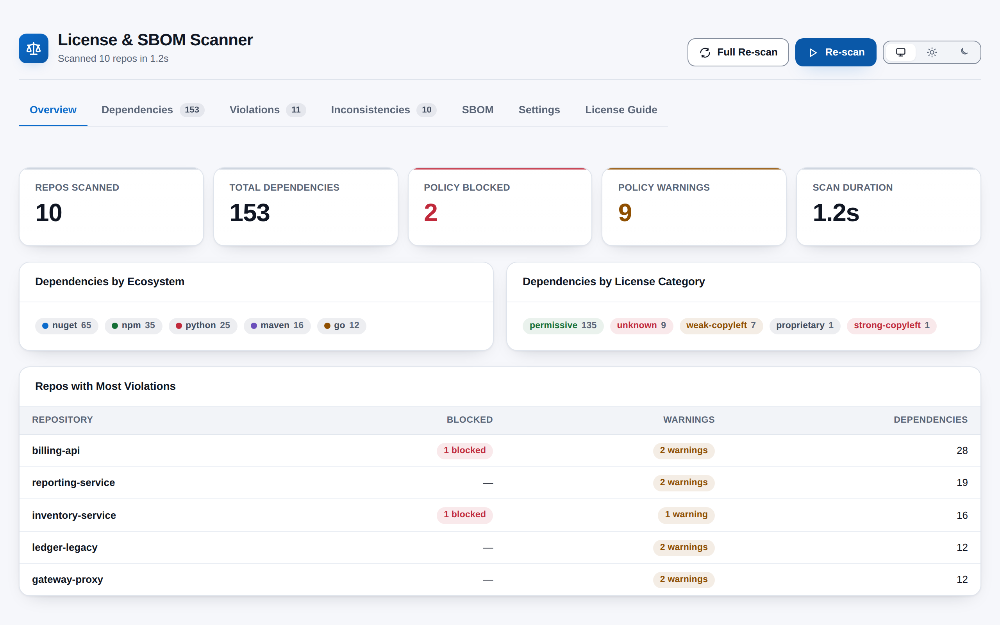
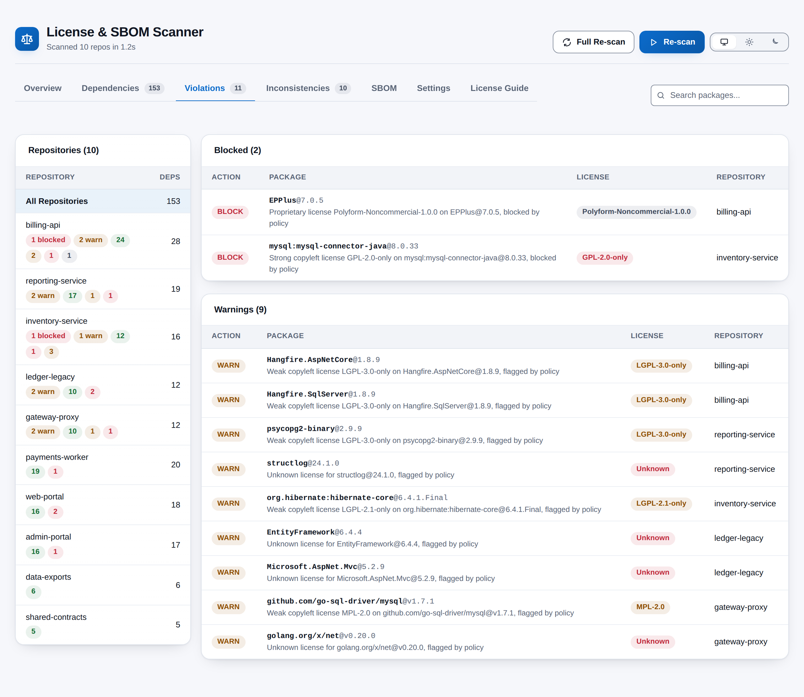

# License & SBOM Scanner

Know exactly what your code ships with. License & SBOM Scanner adds a **Compliance** hub under
**Repos** that scans every Git repository in your Azure DevOps project, resolves each third-party
package to an SPDX license, grades it against your own Allow / Warn / Block policy, spots the same
package pinned at different versions across repositories, and exports a CycloneDX 1.5 Software
Bill of Materials for each repository. One click, one page, no servers to run.

## Features

- **Five ecosystems in one scan** -- NuGet (`.csproj`, `packages.config`,
  `Directory.Packages.props`, `.nuspec`), npm (`package.json`, `package-lock.json`), Go (`go.mod`),
  Python (`requirements*.txt`, `pyproject.toml`, `setup.py`, `setup.cfg`, `Pipfile`) and Maven
  (`pom.xml`).
- **License resolution you can explain** -- A license declared in the manifest is used first, then a
  built-in registry of 352 widely used packages, and anything else is reported honestly as
  Unknown. Common license names are normalised to SPDX identifiers.
- **Five clear categories** -- Permissive, Weak Copyleft, Strong Copyleft, Proprietary / Restrictive
  and Unknown, each with a default action: Allow, Warn, Block, Warn and Warn.
- **A policy that is yours** -- Change the action for any category, override individual SPDX IDs,
  and exclude packages you have already cleared. Violations are grouped into Blocked and Warnings
  with a plain-English reason on every row.
- **Approved packages** -- Approve packages individually or with wildcard patterns such as
  `Microsoft.*` or `@angular/*`, and let the scanner auto-approve the NuGet packages your own
  repositories produce.
- **Version inconsistencies** -- See every package that is pinned differently across repositories,
  with major-version differences called out.
- **CycloneDX 1.5 SBOM export** -- One JSON document per repository, each component with a Package
  URL, previewable on the page and downloadable one at a time or all at once.
- **Built-in license guide** -- A searchable reference of 40 recognised licenses, what each one
  obliges you to do, and how the default policy treats it.
- **Fast re-scans** -- Results are cached for 30 minutes so a re-scan after a policy change is
  near-instant; a Full Re-scan reads everything afresh, and any scan can be cancelled.
- **At home in Azure DevOps** -- Follows your light, dark or high-contrast theme automatically,
  with an optional light/dark override, and meets WCAG AA contrast throughout.

## How it works

1. Open **Repos > Compliance** in any project and click **Scan All Repos**.
2. The scanner lists each repository's default branch, finds the dependency manifests and reads
   them through the Azure DevOps Git REST API, up to 15 repositories at a time.
3. Each manifest is parsed by an ecosystem-specific parser and every package is resolved to a
   license and category.
4. Your policy is applied, versions are compared across repositories and a CycloneDX SBOM is
   generated for every repository.
5. Browse the Overview, drill into any repository's dependencies and violations, review
   inconsistencies, download SBOMs, and tune the policy and approved packages under Settings.

## Permissions

The extension asks for one permission: **read access to your Git repositories** (`vso.code`). It
uses it to list repositories and read dependency files, and never writes to a repository. Your
policy and approved-package settings are kept in the Azure DevOps Extension Data Service for your
organisation, so everyone on the team works from the same rules.

## Privacy

Everything runs in your browser, inside the Azure DevOps page. No source code, dependency data or
license information is sent to any external service; there is no backend, no telemetry and no
lookup against public package registries. The only things saved are your policy and approved
packages (in your Azure DevOps organisation) and your theme preference (in your browser).

## Support

Found a bug or want a feature? Open an issue at
https://github.com/adam-wheater/azure-devops-license-sbom-scanner/issues.

## License

Copyright © 2026 Adam Wheater. All rights reserved. This software is provided under a proprietary source-available license: you may read and audit the code and use the published extension, but you may not copy, modify, redistribute or republish it. See the LICENSE file for the full terms. The open source components it bundles keep their own licenses, listed in THIRD-PARTY-NOTICES.txt inside the package.
